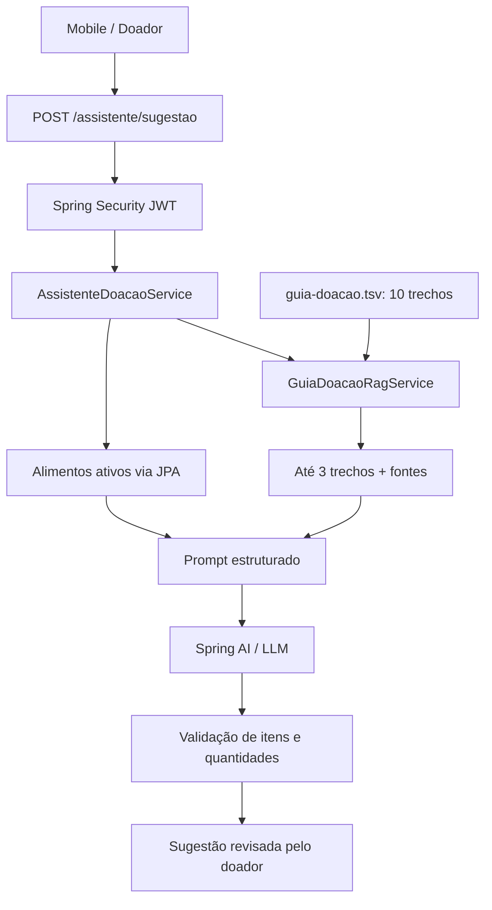

# EloSolidário — IoT, IoB e Inteligência Artificial Generativa

**Global Solution 2026/2 · CitizenTech · FIAP 2TDS**

| Participante | RM | Turma |
|---|---|---|
| João Victor Santana dos Santos | 566063 | 2TDSPX |
| Gabriel Cabral Mendes Mariano | 563230 | 2TDSPO |

**Repositório desta disciplina:** https://github.com/Jsantanadsx/elo-solidario-iot-ia

> Este é o repositório **específico da entrega de IoT/IoB/IA Generativa**. Ele contém uma cópia executável do backend Java do projeto interdisciplinar, com um módulo de **RAG básico** adicionado ao assistente de cadastro de doações. O código da API Java foi inicialmente desenvolvido para outra disciplina; o aprofundamento em recuperação de informação e as evidências desta entrega são documentados separadamente aqui.

## 1. Problema e proposta

A insegurança alimentar convive com a perda e o desperdício de alimentos. O **EloSolidário** conecta pessoas que desejam doar alimentos a beneficiários e instituições. Para diminuir a dificuldade de cadastrar uma doação, utiliza **IA generativa** para transformar uma descrição livre em sugestão de itens, apoiada em informações recuperadas de uma base de conhecimento.

**ODS relacionados:** 2 — Fome Zero; 10 — Redução das Desigualdades; 12 — Consumo e Produção Responsáveis.

**Exemplo de entrada:** “Tenho três pacotes de arroz, dois de feijão e um litro de óleo.” A IA sugere os itens do catálogo, quantidades, unidades e orientações gerais de conservação. **A pessoa revisa tudo antes de publicar.**

## 2. Tecnologias e aprofundamento técnico

- **Java 21**, **Spring Boot 3.5**, **Spring AI 1.1**, **JUnit 5**, **Maven 3.9+**.
- Modelo de linguagem configurável por API compatível com o padrão OpenAI; a aplicação original oferece configuração para Gemini e outros provedores.
- **RAG básico local:** busca lexical determinística sobre dez trechos em TSV, com normalização de acentos, remoção de palavras comuns, pontuação de pertinência e seleção dos três trechos mais relevantes.
- Repositório de dados da aplicação via Spring Data JPA, usado para conferir os IDs de alimentos retornados pela IA.
- Um demonstrador **Python de execução independente**, sem banco nem RabbitMQ, permite testar o conceito com Ollama local usando a **mesma base TSV**. Ele é um instrumento de evidência; **não substitui o endpoint Java**.

**Limite arquitetural:** este RAG não utiliza embeddings nem banco vetorial. Os dez trechos são resumos de referência, não um índice completo dos documentos originais. A fonte e o endereço estão registrados na base, mas ainda é necessário conferir periodicamente sua disponibilidade e a correspondência dos resumos às fontes.

## 3. Arquitetura



O método de busca opera sobre a descrição do doador, recupera os trechos, adiciona o contexto ao prompt do Spring AI e devolve sugestões. Se não houver trechos pertinentes, o contexto orienta o modelo a **não inventar recomendações**. O sistema não afirma que alimentos são seguros para consumo.

## 4. Componentes da implementação

| Componente | Responsabilidade |
|---|---|
| [`GuiaDoacaoRagService.java`](src/main/java/br/com/fiap/elosolidario/rag/GuiaDoacaoRagService.java) | Recuperação lexical, classificação por pontuação e contexto com origem. |
| [`guia-doacao.tsv`](src/main/resources/rag/guia-doacao.tsv) | Base com dez trechos, identificador, assunto, conteúdo, fonte e URL. |
| [`AssistenteDoacaoService.java`](src/main/java/br/com/fiap/elosolidario/service/AssistenteDoacaoService.java) | Injeta contexto RAG no prompt, chama o LLM e valida retorno. |
| [`AssistenteController.java`](src/main/java/br/com/fiap/elosolidario/controller/AssistenteController.java) | Endpoint protegido `POST /assistente/sugestao`. |
| [`GuiaDoacaoRagServiceTest.java`](src/test/java/br/com/fiap/elosolidario/rag/GuiaDoacaoRagServiceTest.java) | Cinco testes unitários do RAG. |
| [`AssistenteDoacaoServiceTest.java`](src/test/java/br/com/fiap/elosolidario/service/AssistenteDoacaoServiceTest.java) | Testes de validação da saída. |
| [`scripts/avaliar_rag.py`](scripts/avaliar_rag.py) | Avaliação exploratória com casos sintéticos, Hit@3 e resultado fora do domínio. |
| [`scripts/demo_rag_local.py`](scripts/demo_rag_local.py) | Demonstração **opcional** do conceito RAG + modelo generativo em Ollama, sem Oracle. |

## 5. Executar e validar

**Requisitos:** JDK 21, Maven 3.9+ e Python 3.11+ somente para os scripts de avaliação/demonstração.

### 5.1 Testes Java (não exigem credenciais de IA)

```powershell
java -version
mvn -version
mvn clean test
mvn "-Dtest=GuiaDoacaoRagServiceTest" test
```

**Resultado registrado no terminal de 18/11/2026:** `BUILD SUCCESS` — **23 testes executados, 0 falhas, 0 erros e 0 ignorados**. O teste `GuiaDoacaoRagServiceTest` realizou **5 verificações aprovadas**. A execução em questão não comprova uma chamada real ao LLM, pois usa testes unitários.

### 5.2 Avaliar recuperação (sem modelo, sem banco)

```powershell
python .\scripts\avaliar_rag.py
python .\scripts\demo_rag_local.py --sem-llm
```

O primeiro comando mede a **taxa de acerto entre os 3 primeiros trechos (Hit@3)** para consultas sintéticas declaradas no script e verifica a consulta fora do domínio. **Execute e registre o resultado real**; não há um valor de métrica presumido neste documento.

### 5.3 Demonstração opcional com LLM local (sem Oracle)

Se o Ollama estiver instalado e o modelo `llama3.2` estiver disponível:

```powershell
ollama list
python .\scripts\demo_rag_local.py --texto "Tenho arroz e feijao em embalagens fechadas. Como posso armazenar para doacao?"
```

O script usa, por padrão, `http://127.0.0.1:11434` e o modelo `llama3.2`; não envia dados de cadastro para um provedor externo. **Esta é uma demonstração autônoma do conceito**, não uma prova de que a aplicação Java com banco funcionou ponta a ponta.

### 5.4 Teste integrado do endpoint Java (pendente de evidência)

A aplicação completa exige Oracle ou Azure SQL com as tabelas/carga inicial, JWT, broker de mensagens e configuração de um provedor de LLM. Configure as variáveis definidas no `application.properties`: `DB_URL`, `DB_USERNAME`, `DB_PASSWORD`, `JWT_SECRET`, `RABBITMQ_URL`, `AI_API_KEY`, `AI_BASE_URL`, `AI_COMPLETIONS_PATH`, `AI_MODEL`. **Não registre esses valores em prints ou arquivos públicos.**

```powershell
mvn spring-boot:run
```

Acesse `http://localhost:8080/swagger-ui.html`, autentique um usuário com perfil **DOADOR**, autorize com JWT e execute `POST /assistente/sugestao`. O corpo pode ser:

```json
{"texto":"Tenho 3 pacotes de arroz e 2 de feijao para doar"}
```

Confira itens, recomendações e aviso de revisão humana. Esse teste só deve ser marcado como concluído quando a resposta real e sua evidência estiverem disponíveis.

## 6. Avaliação, falhas e ética

- **Casos positivos:** alimento seco, validade, refrigerados/congelados, higiene e transporte.
- **Casos negativos:** consulta fora do domínio, produto não alimentar, trecho irrelevante e indisponibilidade do provedor.
- **Métricas:** testes Java; Hit@3 exploratório em consultas sintéticas; análise de erros e limites.
- **Uso responsável:** a IA não certifica segurança alimentar, não determina validade e não publica doações automaticamente. Respostas são sugestões sujeitas a revisão humana.
- **Riscos:** recuperação lexical limitada diante de sinônimos, informações resumidas, fontes potencialmente desatualizadas e alucinações do modelo.

Consulte [`docs/VALIDACAO-IOT.md`](docs/VALIDACAO-IOT.md), [`docs/ROTEIRO-DEMO-IOT.md`](docs/ROTEIRO-DEMO-IOT.md) e [`docs/ARQUITETURA-IOT.md`](docs/ARQUITETURA-IOT.md).

## 7. Entrega da disciplina

O arquivo [`ENTREGA-IOT-FIAP.txt`](ENTREGA-IOT-FIAP.txt) contém nomes, RMs e o link **deste** repositório para envio no Portal FIAP, conforme instruções da disciplina. A documentação e os testes automatizados já estão disponíveis; as **evidências de execução real do LLM e o relatório de métricas** precisam ser anexados antes da entrega final.
